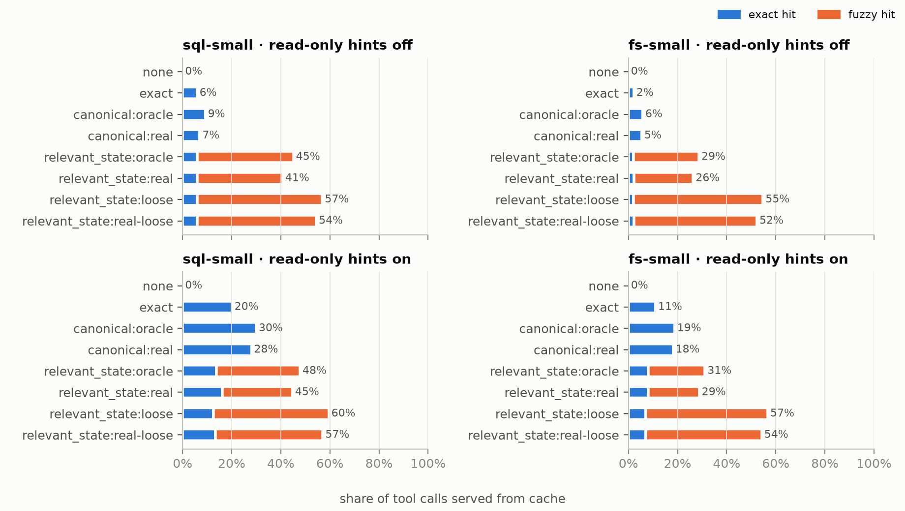

# Midpoint report: Fuzzy cache lookups for partially stateful tool calls

Cornell, Team 30: Harshaan Chugh, Kevin Rodriguez, Etienne Sasenarine, Rohan Shankar.
Advisor: Bhaskar Kataria. Status as of 2026-11-06.

## Problem

TVCache (arXiv 2602.10986) caches tool-call results during agentic RL rollouts. A result is
reused only when the current call and the entire sequence of earlier state-mutating calls match
exactly. Two kinds of reuse are missed:

1. **Spelling differences.** `SELECT name FROM users` vs. `select  name from USERS`, or `cat ./a`
   vs. `cat /app/a`.
2. **Irrelevant history.** A read of table `users` after an unrelated `INSERT INTO orders` can
   safely reuse the result from a rollout without that insert, but exact prefix matching can't.

We add a fuzzy lookup layer: canonicalize calls, track which state each call reads and writes,
and reuse a result when the call is equivalent and the state it reads is identical. Anything
unsupported falls back to exact TVCache.

## What is built

| Component | Owner | Code | Status |
|---|---|---|---|
| Shared interface (`Canonicalizer`, `CallAnalysis`, state keys) | Harshaan | `src/fuzzytv/interfaces.py` | Done |
| Relevant-state tracker and exact-first `RelevantStateExecutor` on upstream TVCache | Harshaan | `src/fuzzytv/state/`, `src/fuzzytv/cache/` | Done (PR #1) |
| SQL canonicalizer (SQLGlot): canonical text, table read/write sets, fail-closed | Kevin | `src/fuzzytv/sql/` | Done (PR #4); column labels and `PRAGMA table_info` fixed after evaluation |
| Filesystem canonicalizer (`cat`, `ls`, `echo`, `cd`) with bash differential tests | Etienne | `src/fuzzytv/fs/` | Done (PR #5) |
| Evaluation harness: four modes, sampled reference validation, false-hit CIs, plots, memory/server parity | Rohan | `src/fuzzytv/eval/`, `slurm/eval.sbatch` | Done (PR #2, #3) |
| SkyRL-SQL rollout collector and Perlmutter GPU job | Rohan | `src/fuzzytv/eval/skyrl_sql.py`, `slurm/collect_skyrl_sql.sbatch` | Built and tested with a scripted model; not yet run on GPUs |
| Benchmark coverage tool | Rohan | `src/fuzzytv/eval/coverage.py` | Done |

Tests: 485 unit tests pass; server integration tests run on Perlmutter. The SQL canonicalizer
also passes a 20,000-query randomized differential test against SQLite.

## How we measure

Modes: `none` (no cache), `exact` (unmodified TVCache), `canonical` (canonical keys, full history
still required) and `relevant_state` (canonical key plus relevant-state identity, after an exact
miss). Each fuzzy mode runs with:
- `oracle`: a spec-perfect canonicalizer, the upper bound;
- `real`: our canonicalizers;
- `loose`: read/write classification only, a deliberately unsafe baseline.

Every reused value is compared against executing the call in a separate reference sandbox that
replays the rollout's own history. A **false hit** is any reused value that differs.

Controlled workloads (`eval/workloads/sql-small.json`, `fs-small.json`; 1,297 tool calls) are
generated from seeds with spelling variants, irrelevant writes, relevant writes and unknown
commands. The in-memory backend made identical decisions to the real TVCache server in every
parity configuration on Perlmutter (jobs 60884044 and 60891246), and the full results below were
reproduced on the real server (job 60891246).

## Results so far

| | SQL, hints off | SQL, hints on | fs, hints off | fs, hints on |
|---|---|---|---|---|
| `exact` hit rate | 5.9% | 20.1% | 2.2% | 11.0% |
| `relevant_state:real` hit rate | **40.8%** | **44.8%** | **26.4%** | **28.8%** |
| `relevant_state:oracle` hit rate | 45.2% | 47.8% | 28.7% | 31.2% |
| false / validated fuzzy hits, real | **0 / 184** | **0 / 151** | **0 / 186** | **0 / 160** |
| false / validated fuzzy hits, real-loose | 45 / 256 | 46 / 231 | 87 / 386 | 87 / 364 |
| executions vs. `none`, `exact` | 1.00 | 0.83 | 1.00 | 0.91 |
| executions vs. `none`, `relevant_state:real` | 0.92 | 0.58 | 0.99 | 0.73 |

"Hints" marks read-only calls as not mutating state, as a tool that declares its reads would.

1. **Correct.** 0 false hits in 681 validated fuzzy hits from our canonicalizers (95% upper bound
   0.6%). The loose baseline has 18–24% false hits, so read-dependency tracking is what makes
   fuzzy reuse safe.
2. **Close to the upper bound.** Our canonicalizers reach about 90% of the oracle's fuzzy hits. The
   remaining misses are `sqlite_master` schema queries and shell control operators.
3. **Hit rate is not saved work.** Without read-only hints, skipped reads are replayed on the next
   miss: a 41% hit rate saves 8% of SQL executions. With hints, `relevant_state:real` saves 42%
   (SQL) and 27% (fs), vs. 17% and 9% for exact TVCache.
4. **The harness found real bugs.** SQLite names unaliased result columns after their text as
   typed, so `SUM(x)` and `sum(x)` return different values. A spec-following oracle and the first
   SQL canonicalizer both produced false hits from this until fixed. `PRAGMA table_info` was
   treated as unknown, which disabled fuzzy lookup for the rest of the rollout (4 → 184 fuzzy
   hits after the fix).
5. **Coverage on real benchmark text.** 96.6% of SkyRL-SQL's 653 gold queries are fuzzy-eligible
   reads (the rest use `'now'`/`random()`). Only 15% of terminal-bench reference solution commands
   are; most are installs, variable expansion and `&&` chains, which correctly fall back to exact.

Full tables: `docs/evaluation.md`.

## Real workloads and plan to the final report

We use the TVCache paper's workloads:
- SkyRL-SQL: 653 questions, Qwen2.5-Coder-7B, 5 samples per question.
- terminal-bench easy (51) and medium (95), from the advisor's container-manager.

| Item | Plan | Risk |
|---|---|---|
| SkyRL-SQL rollouts | `slurm/collect_skyrl_sql.sbatch`, about 1–2 GPU-node hours for 3 passes; replay through all modes | vLLM install on Perlmutter's Python untested |
| terminal-bench rollouts | Needs Docker Compose, which Perlmutter compute nodes lack. Need a Linux Docker host (advisor's servers or a cloud VM) | Blocking; the server also returns the whole tmux pane, so results are not call-local without per-command output extraction |
| fs coverage | `mkdir`, `&&` sequences of supported commands, `$VAR` with a known environment | Medium |
| SQL schema key | A state key for `sqlite_master` reads | Low; interface change |
| RL runs with verl (reward, step time) | Advisor's setup, small runs | Depends on terminal host |
| Upstream PR, figures, report | Final week | — |
